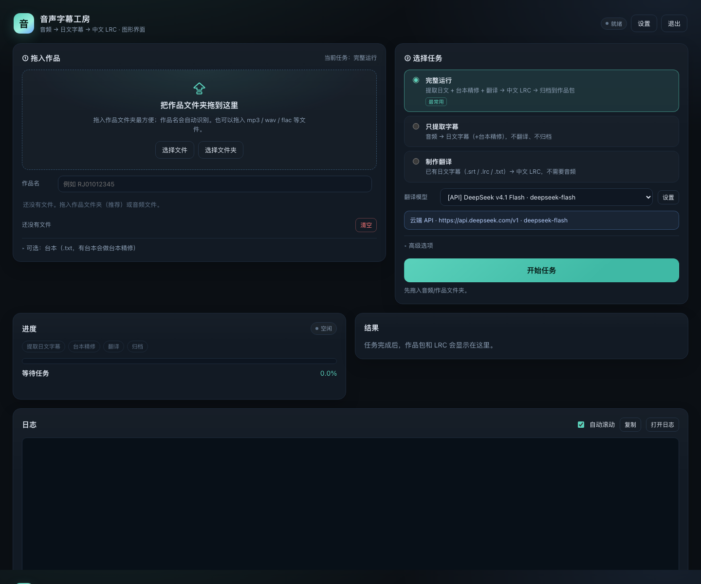
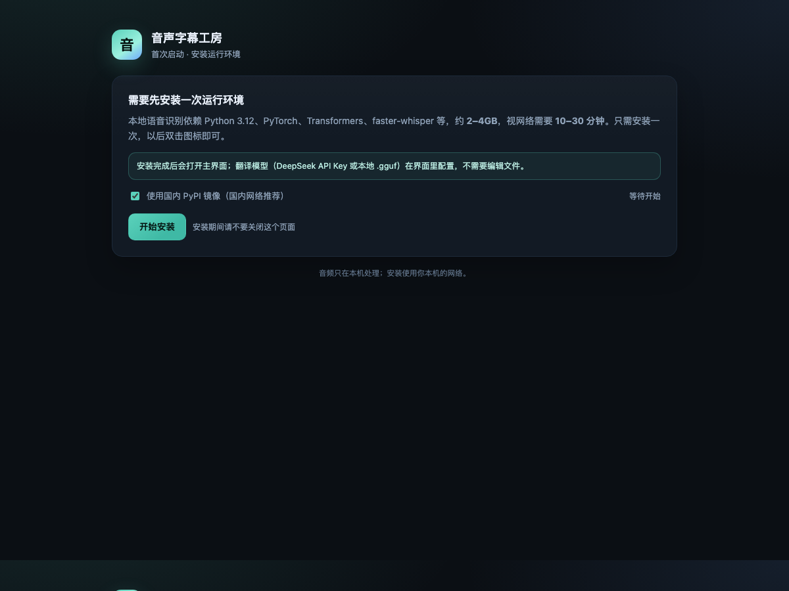

# 音声字幕工房 · 图形界面（新增）

> 这个目录集中放**可视化 App** 的全部新增代码：本地 Web 界面、任务编排、模型/API 设置、
> 双击启动器、首次安装页、打包脚本、测试和文档。
>
> 原来的 CLI/项目说明在 [根目录 README](../README.md)，与本目录完全分开；CLI 用法不受影响。



## 快速开始

### 本机 macOS（开发机）

项目根目录已有 `gui_app/音声字幕工房.app`，**双击即可**。启动器会找到上一级的项目根，
使用项目现有 `.venv` 启动 GUI，用 Chrome/Edge 的 app 模式开一个窗口（失败回退默认浏览器）。

也可以从源码启动：

```bash
python3 gui_app/gui.py                 # 自动打开浏览器
python3 gui_app/gui.py --no-browser    # 只打印地址
python3 gui_app/gui.py --port 9000
```

### 发布包（给普通用户）

```bash
# macOS 开发机上构建（需要 PyInstaller；会自动带内置 Python/uv 和首次安装页）
python3 gui_app/tools/build_release.py --version 0.2.0

# 只验证目录结构
python3 gui_app/tools/build_release.py --skip-launcher --skip-tools --no-zip --out /tmp/rel
```

- macOS：双击 `音声字幕工房.app`
- Windows：双击 `ASMR-Translator.exe`（需在 Windows 或 CI 上构建，PyInstaller 不能跨平台编译）
- Linux：给 `ASMR-Translator` 执行权限后双击（需在 Linux 或 CI 上构建）

首次启动会打开安装页（约 2–4GB，10–30 分钟），之后在界面里配置模型/API。



## 功能

- **主界面**：拖入作品文件夹/音频/台本/字幕 → 选「完整运行 / 只提取字幕 / 制作翻译」→
  高级选项 → 实时进度/日志/取消 → 结果打开文件夹/预览 LRC/下载 ZIP。
- **设置 → 本地模型**：系统文件窗口选择 `.gguf`，自动识别模型名称、参数量、量化
  （Q6_K / IQ4_XS 等）、架构、上下文、分片；模型原地使用、不复制、不上传；
  显示名可改，会写进 LRC 的 `[by:]`。
- **设置 → 云端 API**：DeepSeek 官方或任意 OpenAI 兼容端点；填 Key/Base URL/模型，
  测试连接、保存、清除；Key 只在本机 `.env`（0600），接口/日志不回显。
- **安全**：服务只绑定 `127.0.0.1`，随机 token，Host/Origin 校验，路径白名单。
  设置只写 `config.local.yaml` 和 `.env`，不碰 tracked 的 `config.yaml`。

## 目录

```
gui_app/
├── gui.py              开发入口（优先转入项目 .venv）
├── gui_server.py       本地 HTTP 服务 + 页面路由
├── gui_fs.py           路径/暂存/落盘/结果/ZIP
├── gui_jobs.py         三阶段任务编排、进度、取消
├── gui_models.py       模型注册表、GGUF 识别、API 设置
├── gui_platform.py     跨平台底座（进程树/原生窗口/浏览器/休眠）
├── gguf_meta.py        GGUF 头部解析
├── webui/              主界面 + 设置页（原生 JS/CSS）
├── launcher/           PyInstaller 启动器 + 首次安装页 + 图标
├── tools/              build_release.py
├── tests/              stdlib unittest（三平台 CI）
├── docs/               用户指南 / 维护者指南 / 截图
├── 使用说明.txt        发布包给普通用户的说明
├── VERSION
└── 音声字幕工房.app     本机双击启动（构建产物，已在 .gitignore）
```

## 设置写入

- 本地模型 → `config.local.yaml` 的 `translation.registry.local-<slug>`；
- 云端 API → `config.local.yaml` + `.env`；
- 模型路径原地使用；显示名/量化写进 LRC `[by:]`；
- 绝不修改 tracked 的 `config.yaml`。

## 测试与发布

```bash
# 38 个单测（不需要模型/Key；三平台 CI 也跑）
python3 -m unittest discover -s gui_app/tests -v

# 启动器安装页自检（打包产物也可用）
python3 gui_app/launcher/launcher.py --self-check --no-open

# 组装便携发布包
python3 gui_app/tools/build_release.py --version 0.2.0
```

- 测试覆盖 GGUF 识别、暂存/结果、模型/API 设置、任务编排/取消、HTTP 认证/上传；
  API 用本地 mock，不消耗真实额度。
- 发布包布局：根目录放原项目 + 双击启动器 + `.tools`（内置 Python/uv），
  `gui_app/` 放 GUI 代码；首次安装页创建 `.venv` 后启动。
- CI 在根目录 `.github/workflows/`：三平台单测 + tag 构建三平台 zip。
  GitHub Actions 必须放在仓库根，因此这两个 workflow 和 `.gitattributes`/`.gitignore`
  是仅有的留在根目录的配套文件。

## 图标

- macOS：[launcher/assets/icon.icns](launcher/assets/icon.icns)
- Windows：[launcher/assets/icon.ico](launcher/assets/icon.ico)（16–256 多尺寸）
- Linux/预览：[launcher/assets/icon.png](launcher/assets/icon.png)

## 文档

- [用户指南](docs/用户指南.md)：下载、首次安装、设置、任务、常见问题
- [维护者指南](docs/维护者指南.md)：架构、数据流、HTTP API、模型识别、启动器、发布、测试
- [发布说明](使用说明.txt)
- 原 CLI 用法：[根目录 README](../README.md)
