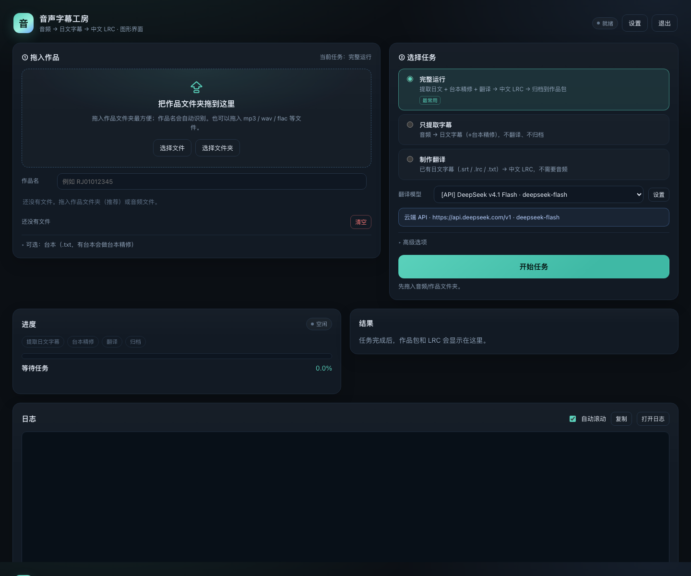
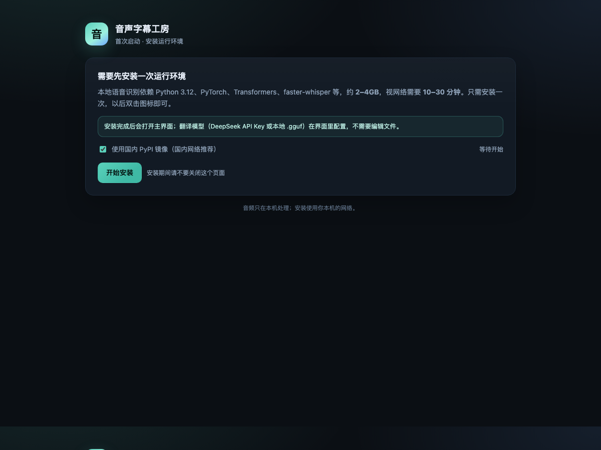

# 用户指南（图形界面版）

> 适合不想使用命令行的用户。开发者/贡献者请看 [维护者指南](维护者指南.md) 与根目录 README。

## 1. 下载与首次启动

1. 从 GitHub Releases 下载对应系统的 zip：
   - macOS：`ASMR-Translator-<版本>-macOS-<架构>.zip`
   - Windows：`ASMR-Translator-<版本>-Windows-x64.zip`
   - Linux：`ASMR-Translator-<版本>-Linux-x64.zip`
2. **整个文件夹解压**到文稿/桌面等可写位置，不要放在需要管理员权限的目录，
   也不要只把图标拖出来。
3. 双击：
   - macOS：`音声字幕工房.app`
   - Windows：`ASMR-Translator.exe`
   - Linux：`ASMR-Translator`（文件管理器里允许“作为程序执行”）

4. 第一次会打开安装页：
   - 约 2–4GB，10–30 分钟；
   - 国内网络可勾选 PyPI 镜像；
   - 完成后自动打开主界面；以后双击图标即可。
5. 系统安全提示：
   - macOS“无法验证开发者”：右键图标 → 打开 → 打开（只需第一次）；
   - Windows“Windows 已保护你的电脑”：更多信息 → 仍要运行；
   - 未签名应用可能被杀毒软件误报，可加入信任；有签名版本时优先用签名版。

## 2. 设置翻译方式

主界面右上角「设置」。第一次没有可用模型时也会自动打开。

### A. 云端 API（推荐给非技术用户）

- 服务默认 DeepSeek 官方；也可以填任意 OpenAI 兼容端点；
- 填 API Key；需要时改 Base URL / 模型；
- 点「测试连接」：会读取模型列表并发一条极短测试（可能产生少量费用）；
- 保存后主界面模型下拉出现该 API；
- Key 只保存在本机 `.env`，接口和日志都不回显；只把字幕文本发给该 API。

### B. 本地模型

- 点「选择模型文件」：在系统窗口里选 `.gguf`；也可以「选择模型文件夹」；
- 应用读取 GGUF 头部，自动识别：
  - 模型名称（`general.name`）；
  - 参数量（`general.size_label` / 文件名）；
  - 量化（`general.file_type`，如 18→Q6_K；30→IQ4_XS；文件名兜底）；
  - 架构、上下文长度、是否有聊天模板、是否分片；
- 可以修改“显示名称”；它会写进 LRC 的 `[by:]`；
- 保存后会出现在主界面模型下拉；
- 模型**原地使用，不复制、不上传**；之后不要移走/删除它；
- 本地模型需要 llama.cpp 的 `llama-server`；没有就改用云端 API。

### C. 只提取字幕

可以先不配置翻译模型；任务只做 ASR（和台本精修，如果提供了台本）。

## 3. 运行任务

1. 把作品文件夹拖进左上角拖拽区（推荐），或点「选择文件」；
2. 作品名自动识别，可手动修改；
3. 选择任务：
   - **完整运行**：提取 + 台本精修 + 翻译 → 中文 LRC → 归档；
   - **只提取字幕**：音频 → 日文字幕；
   - **制作翻译**：已有 `.srt` / `.lrc` / `.txt` → 中文 LRC；
4. 可选：拖入台本 `.txt`（按轨道号命名，如 `01.txt`）；
5. 点「开始任务」；可看进度/日志、可取消；
6. 结果：
   - `output/<作品>/`：作品包（`字幕文件/日文`、`字幕文件/中文`、`音频`、`台本`）；
   - `LRC成品库/<作品>/`：只放中文 LRC，方便导入播放器/asmr.one；
   - 页面上的按钮可直接打开文件夹、预览 LRC、下载 ZIP。

## 4. 高级选项

- 强制重跑：忽略已有字幕/翻译缓存；
- 中日对照：LRC 同一时间戳先中文后日文；
- 不归档：产物留在工作区；
- 台本精修只用规则：不加载模型，速度快；
- 试翻前 N 行：不归档，确认效果后请正常跑一次；
- 任务期间阻止系统休眠（默认开）：长任务更稳；合盖休眠仍会中断。

## 5. 数据与隐私

- 音频、字幕、作品包都在你解压的文件夹里；
- 本地模式全程离线（首次下载 ASR/依赖除外）；
- 云端模式只把字幕文本发给你配置的 API，不上传音频；
- 应用不做遥测；诊断信息由你主动复制；
- 卸载：退出界面后删除整个文件夹即可（没有系统级安装）。

## 6. 常见问题

**Q：双击没反应/提示找不到文件？**
确认启动图标和 `scripts/`、`webui/` 在同一个解压文件夹里；不要单独移动图标。

**Q：提示文件夹只读/请移到文稿？**
把整个文件夹移到“文稿”或桌面，不要放在“应用程序”“Program Files”。

**Q：安装失败/很慢？**
检查网络/代理；在安装页切换 PyPI 镜像后重试；确认磁盘空间足够（建议 10GB+）。

**Q：模型下拉里没有我的模型？**
到设置页检查路径是否失效；本地模型需要 `.gguf`，并且文件仍在该位置。

**Q：本地模型选了但不能用？**
需要安装 llama.cpp 的 `llama-server` 并加入 PATH；或改用云端 API。

**Q：云端 API 测试失败？**
401/403 多为 Key 错误；404 多为 Base URL 路径不对；模型名不在列表里会提示可用模型。

**Q：LRC 第一行标题看不到？**
首条字幕从 0 秒开始可能盖住标题；可在 `config.yaml` 调 `lrc_title_at_ms` 或关掉 `lrc_title_line`。

**Q：改了提示词但没变化？**
翻译缓存按日文原文命中；用「强制重跑」或删除对应 `.zh.cache.json`。

**Q：关闭窗口后任务还在吗？**
在。服务会在后台保留，双击图标可再次打开；页面「退出」会关服务；空闲一段时间会自动退出。

**Q：升级怎么办？**
下载新版本解压，把旧文件夹的 `input/`、`output/`、`LRC成品库/`、`.models/`、`.env`、
`config.local.yaml` 复制到新文件夹；`.venv` 会重新安装。

**Q：支持 Windows/Linux 吗？**
图形界面和启动器按三平台设计；实际 ASR/翻译取决于你的硬件、模型和 llama.cpp。
Linux 的桌面集成因发行版而异；Windows 需要 `llama-server.exe` 才能用本地模型。
